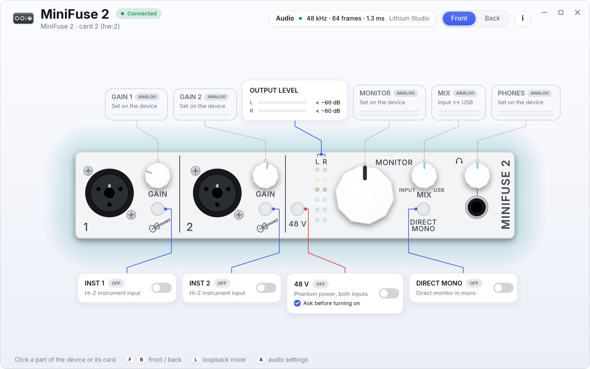
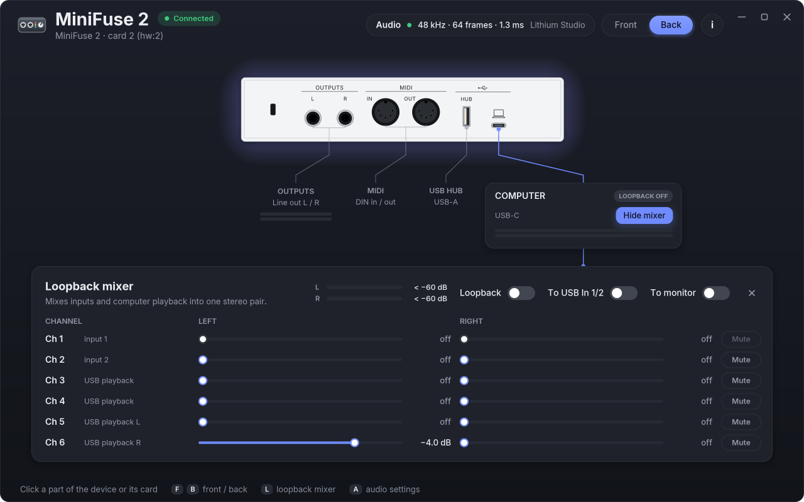
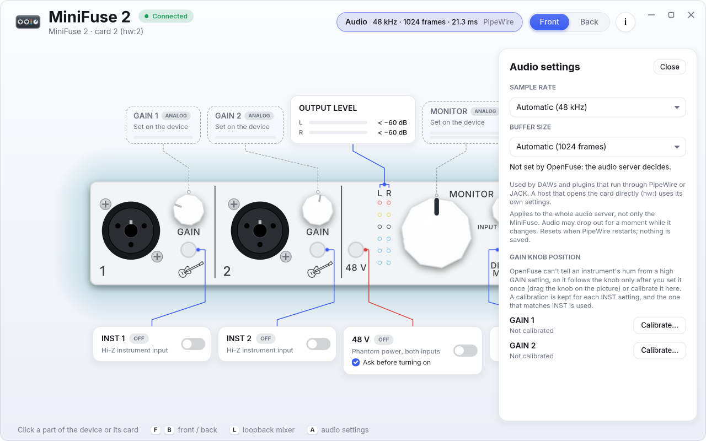
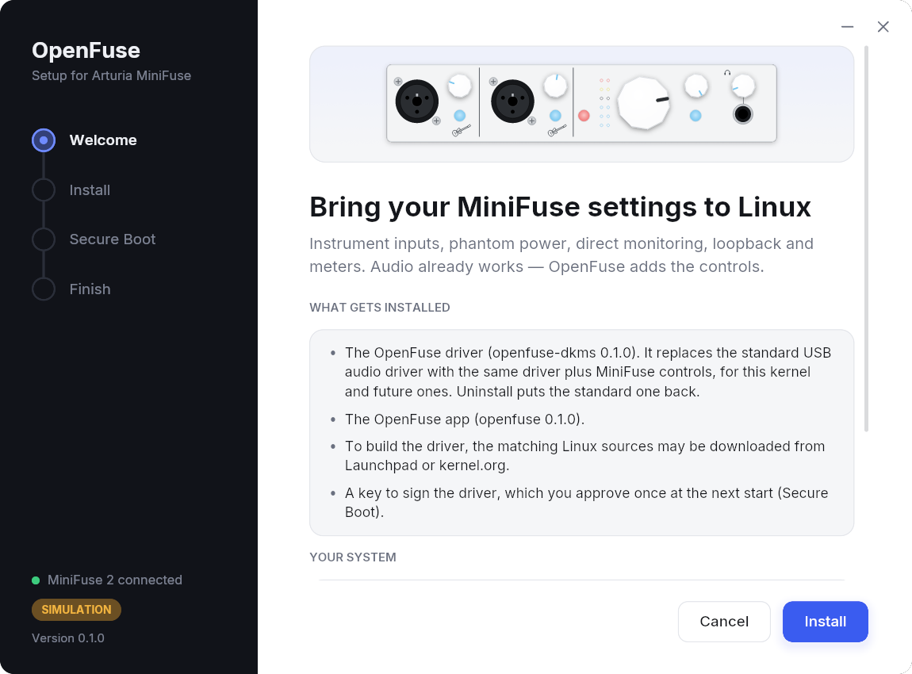
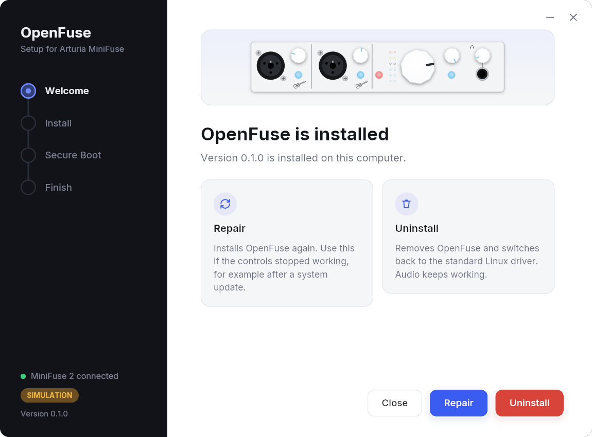

<p align="center">
  
</p>

<h1 align="center">OpenFuse</h1>

A Linux control panel for the Arturia MiniFuse family of USB audio
interfaces: MiniFuse 1, MiniFuse 2 and MiniFuse 4.

MiniFuse interfaces already play and record audio on Linux with the
standard driver. Their settings, though, are only reachable from Arturia's
Windows and macOS software. OpenFuse adds them on Linux: the instrument
inputs, 48 V phantom power, direct monitoring, the level meters and the
loopback mixer.



## Features

- **The device as you see it.** A drawing of the front and back panel, with
  every switch, light and meter live. Buttons pressed on the hardware show
  up in the app right away.
- **Switches:** INST (Hi-Z) for the instrument inputs, 48 V phantom power
  (asks before turning on), Direct Mono.
- **Level meters** for the inputs and the output, with clip indicators.
- **Loopback mixer:** mix the inputs and computer playback into one stereo
  pair that goes back to the computer. Useful for streaming and podcasts.
- **Audio settings:** sample rate and buffer size for PipeWire, and which
  app is using the interface right now.
- **Tray icon:** switches, current audio settings and a 48 V indicator,
  one click away. Optional start at login.
- Light and dark themes, following your desktop.

<table>
  <tr>
    <td></td>
    <td></td>
  </tr>
  <tr>
    <td align="center">Loopback mixer</td>
    <td align="center">Audio settings</td>
  </tr>
</table>

## Supported devices

| Device | Status |
|---|---|
| MiniFuse 2 | Supported: every feature above, tested on hardware |
| MiniFuse 1 | In progress: the app's layout is ready; the driver doesn't recognise the device yet |
| MiniFuse 4 | In progress: the app's layout is ready; the driver doesn't recognise the device yet |

If you have a MiniFuse 1 or 4, please open an issue with the output of
`lsusb | grep -i arturia`. Its USB ID is the first step to supporting it.

**Systems:** Debian, Ubuntu and their derivatives, x86_64. Secure Boot is
supported: the installer walks you through approving the driver's signing
key (one restart).

## Install

Download `openfuse-<version>-x86_64.tar.gz` from the
[Releases](../../releases) page, unpack it and run the installer:

```sh
tar xzf openfuse-0.1.0-x86_64.tar.gz
./openfuse-0.1.0-x86_64/openfuse-installer
```

The installer sets up everything (the driver, the app and the kernel
headers the driver needs) and asks for your password the usual way. Run
it again any time to update, repair or uninstall. Uninstalling switches
back to the standard Linux driver, and audio keeps working.

<table>
  <tr>
    <td></td>
    <td></td>
  </tr>
</table>

The download folder holds the installer next to the two Debian packages it
installs: `openfuse-dkms` (the driver) and `openfuse` (the app). You can
also install them by hand with `apt install ./openfuse*.deb`.

## How it works

The MiniFuse only accepts its settings through the same USB interface the
audio uses, which belongs to the kernel's `snd-usb-audio` driver. A normal
app can't reach it without cutting the audio. So OpenFuse has two parts:

- **`kernel/`: a mixer quirk for `snd-usb-audio`.** It exposes the
  MiniFuse settings and meters as ordinary ALSA controls. It ships as a
  DKMS package, which rebuilds the module for each kernel and falls back to
  the stock driver if a build fails. It is written in upstream style, so
  it can be submitted to the mainline kernel.
- **`app/`: the control panel and tray icon.** It talks only to those ALSA
  controls, never to USB directly. `amixer` and `alsamixer` see the same
  controls.

The protocol is documented in [docs/protocol.md](docs/protocol.md).

## Building from source

You need Rust 1.88 or newer, the ALSA headers (`libasound2-dev`), `dkms`
and your kernel's headers.

```sh
make release   # -> dist/openfuse-<version>-x86_64.tar.gz (installer + both packages)
make test      # every test suite: app, installer, kernel
```

| Directory | Contents |
|---|---|
| [app/](app/) | the control panel (Rust, iced): see [docs/app.md](docs/app.md) |
| [kernel/](kernel/) | the driver quirk, DKMS and Debian packaging: see [docs/kernel.md](docs/kernel.md) |
| [installer/](installer/) | the graphical installer (Rust, iced; uses PackageKit) |
| [docs/](docs/) | the protocol specification, app and driver documentation, screenshots |
| [assets/render/](assets/render/) | the device drawings (SVG), made by [tools/render_devices.py](tools/render_devices.py) |

## License

OpenFuse is free software. The app and the installer are licensed under the
[GNU GPL v3.0 or later](LICENSE). The kernel driver in `kernel/` is
licensed under the [GNU GPL v2.0](kernel/COPYING), like the Linux kernel it
builds into.

The Inter font is bundled under the SIL Open Font License 1.1.

Arturia and MiniFuse are trademarks of Arturia. OpenFuse is an independent
project, not affiliated with or endorsed by Arturia. The device drawings
are original artwork.
