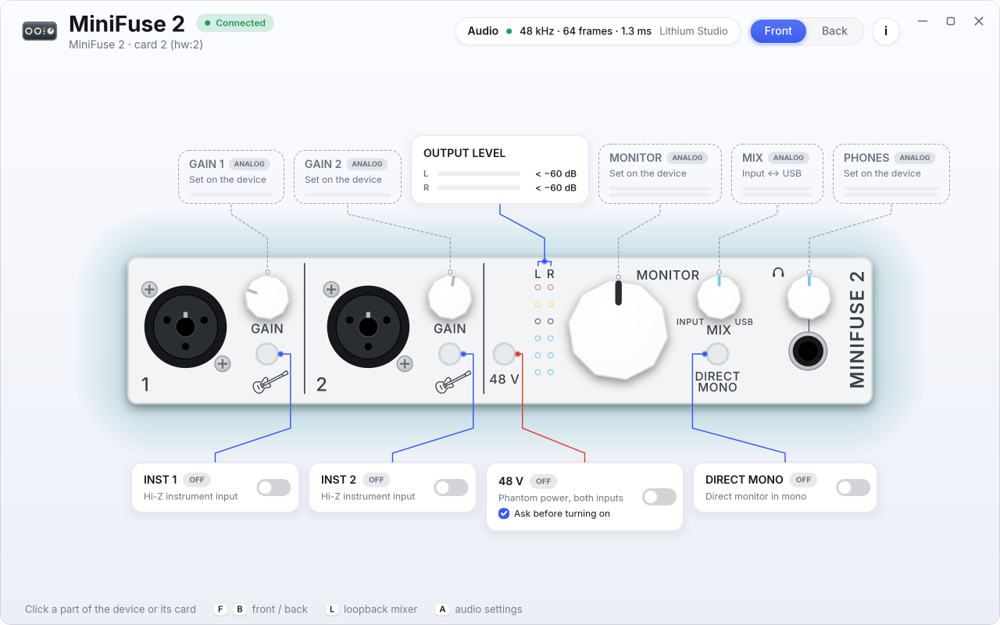

# OpenFuse

Desktop control panel for Arturia MiniFuse interfaces on Linux: INST, 48 V,
DIRECT MONO, level meters and the loopback mixer, plus a tray icon. Audio
already works with the stock `snd-usb-audio` driver. This app only changes
device settings, and only through the ALSA controls added by the OpenFuse
kernel quirk (`docs/protocol.md` §7.1). It never talks to USB.

One self-contained binary: the device renders (`assets/render/*.svg`), the
Inter font (SIL OFL, `assets/fonts/`) and the icons are compiled in. At run
time it needs only libc, `libasound.so.2` and the desktop's graphics stack.



## Build

Rust ≥ 1.88 and the ALSA headers (`libasound2-dev` / `alsa-lib-devel`,
found through `pkg-config`). Wayland and X11 are loaded at run time, no
`-dev` packages needed for them.

```sh
cd app
cargo build --release            # -> target/release/openfuse
cargo test                       # unit + UI tests (headless, no display needed)
cargo clippy --all-targets
cargo run --release --example screenshots     # -> screenshots/*.png
```

Cargo features: `gpu` (default) uses wgpu (Vulkan/GL, loaded at run time) and
falls back to the tiny-skia software renderer. `--no-default-features` builds a
software-only binary (smaller; the window then keeps square corners, because
software presentation has no alpha channel).

### Portable release binaries

The binary links glibc dynamically, so build it on (or for) the oldest glibc
you want to support; the result runs on anything newer. A host build here
requires glibc 2.44. Practical options:

* Build inside an old distribution container, e.g. Debian 11 (glibc 2.31) or
  Ubuntu 20.04: install `rustup`, `pkg-config`, `libasound2-dev`, then
  `cargo build --release`. For **aarch64** use the same image for `arm64`
  (native arm64 runner, or `docker buildx --platform linux/arm64` under qemu).
* Cross-compile with [`cross`](https://github.com/cross-rs/cross)
  (`cross build --release --target aarch64-unknown-linux-gnu`) using an image
  that adds `libasound2-dev:arm64`; or `cargo zigbuild --target
  x86_64-unknown-linux-gnu.2.28` with a sysroot that contains alsa-lib's
  headers and `libasound.so` for `pkg-config`.

Check the result with `ldd target/release/openfuse` (expect only libasound,
libgcc_s, libm, libc) and `objdump -T … | grep -o 'GLIBC_[0-9.]*' | sort -uV | tail -1`.

## Run

```sh
openfuse                    # real device; waits for one if none is plugged in
openfuse --mock             # always simulate a MiniFuse 2
openfuse --mock --model minifuse4   # layout preview of other models
openfuse --theme dark       # auto (default: XDG portal colour scheme) | light | dark
openfuse --card 3           # pick an ALSA card explicitly
openfuse --tray             # start hidden in the tray (used by "Start at login")
openfuse --no-tray          # never use the tray; closing the window quits
openfuse --list-controls    # the card's ALSA controls and which OpenFuse names resolve
openfuse -v                 # diagnostics on stderr
```

Backend selection:

1. The app looks for a MiniFuse in `/proc/asound/card*/usbid` (model table,
   matched on VID:PID; for Arturia devices whose PID is not known yet, on the
   card name).
2. If the card exposes the OpenFuse controls it uses **`AlsaBackend`**.
3. With no MiniFuse at all it shows *No MiniFuse connected* (no simulation)
   and checks `/proc/asound` every 2 s; when one is plugged in, or plugged
   back in after a disconnect, it switches to it (`App::switch_backend`).
4. A MiniFuse without the kernel module's controls uses **`MockBackend`** and
   shows a **SIMULATED** notice with the reason; so does `--mock`.

With a real device, a control the driver does not expose is shown disabled
("Not exposed by the driver"); the rest keeps working.

### Using it

* **Front / Back** (keys `F` / `B`) switch the render.
* Each live part has a callout card and a coloured leader line. Operate it
  from the card or click the part on the render (hit areas are larger than
  the drawing). Lenses and the LED ladder on the render show the device
  state live; a button pressed on the hardware lights up at once, its card
  flashes and the status line names the change.
* Level shows on the render only through its own LED ladder (top red, then
  yellow, then blue; the output pair, measured on the computer). Meter bars
  live inside the callout cards: OUTPUT LEVEL (the ladder's card), GAIN 1 / 2
  (inputs 1 / 2), MONITOR, MIX, PHONES, OUTPUTS and COMPUTER (output pair),
  MiniFuse 4 rear INPUTS 3 / 4. Meters rise instantly, fall at 24 dB/s and
  hold their peak for 1 s.
* **Clipping**: a reading at or above −0.1 dBFS (`CLIP_DBFS` in
  `src/levels.rs`, unverified: full scale still to be confirmed, spec §5)
  turns the end of the card's bar red and shows a red CLIP pill in the card
  header (CLIP L / R / L R for pairs); the ladder's top LED and the GAIN
  knob light go red. All latch for 2 s after the last clip (`CLIP_LATCH`);
  clicking a pill clears it. While latched the tray tooltip says
  "clipping on Input 1". The simulator clips now and then.
* **GAIN knob lights**: the light line on each input GAIN knob is that
  input's meter, as on the hardware: grey without signal, blue getting
  brighter with level, red while clipping (`knob_lights` in the meter table).
  The knob's angle is the virtual knob's (below).
* Analog knobs (GAIN, MONITOR, MIX, PHONES) have dashed, muted callouts tagged
  *ANALOG*. Their positions are not reported over USB (spec §4.2); GAIN's
  effect shows up on the input meters.
* **48 V** asks for confirmation before switching on (also from the tray).
  *Cancel* is the default; Enter activates the focused button, Tab / arrows
  move the focus, Escape cancels. *Don't ask again* (unticked by default) is saved
  only when you confirm with *Turn on 48 V*; turn asking back on with *Ask
  before turning on* on the 48 V card or *Ask before turning on 48 V* in the
  tray. Settings live in `$XDG_CONFIG_HOME/openfuse/settings.ini` (created on
  first write; a missing or unreadable file means defaults). Switching 48 V off, or pressing the button
  on the hardware, needs no confirmation.
* **Loopback mixer**: on the back view, the USB-C ("COMPUTER") callout or key
  `L`. Three switches, per-channel L/R gain (0.5 dB steps, bottom notch =
  *off*), mute pills, meters. Items marked ⚠ are not yet verified on hardware.
* **Audio settings** (header button *Audio*, key `A`, or *Audio settings…* in
  the tray): a slide-out to choose the sample rate (44.1 to 192 kHz) and the
  buffer size (32 to 2048 frames, shown with its latency). It sets
  PipeWire's `clock.force-rate` / `clock.force-quantum` at run time, so DAWs
  and plugins that run through PipeWire or JACK follow it (a host that opens
  `hw:` directly does not). The clock is global to the audio server, not per
  device; nothing is written to disk and PipeWire forgets it on restart.
  *Back to automatic* releases both. The simulator uses an in-memory clock.
  An app that opens the card directly (ALSA `hw:`, as many DAWs do) chooses
  its own rate and buffer and bypasses the server: the panel then names that
  app and shows what it opened (from `/proc/asound`, `src/alsa_stream.rs`).
  OpenFuse cannot change that stream; set its rate and buffer in the app.
* **Virtual knobs.** The device cannot report its analog knobs: no USB path
  carries them (state block, meters and MIDI were logged while every knob was
  turned end to end; `docs/protocol.md` §4.2). **MONITOR, MIX and PHONES** are
  drawn at a fixed 12 o'clock and can't be turned on screen. **GAIN** can: drag
  it up or down (or scroll over it) to match the hardware, double-click to
  reset. Its input meter is post-gain, so from there the knob follows the
  input's idle noise ("Estimated · 45%"; held while you play, "Last known").
  The instrument's level learned when you set it is saved, so the estimate
  carries on after a restart. Setting a calibrated knob by hand corrects the
  calibration (it is shifted so the current level reads where you put it;
  saved per INST setting, double-click goes back to the calibration as
  recorded). Or run **Calibrate…** in the Audio panel: GAIN
  is turned to 7:30, 9:00, 12:00, 3:00 and 4:30 with your setup as you use it
  (2 s settle, 6 s record; unsteady recordings are refused; it needs at least
  6 dB between minimum and maximum; *Reset* removes it). With nothing plugged
  in, the converter's own noise hides the bottom of the travel: the card then
  says "under N%". How far that reaches depends on the input (on one MiniFuse 2,
  input 1's converter is ~4 dB noisier than input 2's, so GAIN 1 is blind
  below about 9:30). The fix for an empty input: plug in an empty jack (an
  adapter will do) and turn INST on before calibrating, and leave them so; the
  open Hi-Z input's own noise then shows the whole travel. A calibration only
  holds for the setup it was recorded with. INST is the part OpenFuse can see,
  so each knob keeps one calibration per INST setting (e.g. empty with INST
  off, and an empty jack with INST on) and uses the one that matches INST.
  With only the other one recorded, the card says "Calibrated with INST on".
  The wizard records for the INST setting it was opened with and pauses if
  INST is switched. Each input's converter floor is learned and saved.
* The header's Audio chip always shows what the audio is running at (an app
  on the card directly, else PipeWire's clock, tagged *SET* when OpenFuse
  forced it). The round **i** button opens *About* (credits; Esc / Enter /
  Close dismiss it).
* The window opens at 1200 × 760 (the smallest default where the loopback
  panel still fits; minimum 1060 × 600). It has its own title controls
  (minimize, maximize/restore, close).
  Drag it by any empty area or the header; double-click the header to
  maximize; resize from the edges. On Wayland it has rounded, transparent
  corners (with the GPU renderer).
* **Tray**: status line, INST 1/2, 48 V (same confirmation), Direct Mono and
  Loopback toggles that follow the device, Open, *Audio settings…*, *Start at login*
  (`$XDG_CONFIG_HOME/autostart/openfuse.desktop`, launching `openfuse
  --tray`), *Notify when 48 V is switched on the device*, Quit. Left click
  shows/hides the window. The icon is a monochrome glyph (`icons::tray_svg`) whose
  color is chosen for the panel: light on GNOME / Ubuntu (dark top bar),
  elsewhere light or dark by the desktop preference; `OPENFUSE_TRAY_ICON=light|dark`
  overrides. It has a red "48" badge while phantom power is on and is
  greyed/struck through when the device is not connected. Closing
  the window hides it to the tray only when a tray host is actually present;
  otherwise closing quits. While the window is hidden, meters are not polled.
* A second launch only raises the running window (Unix socket + `flock` in
  `$XDG_RUNTIME_DIR`).

Debug aids: `OPENFUSE_DEBUG=1` (same as `-v`) logs messages;
`OPENFUSE_SNAPSHOT=out.png` saves a screenshot of the real window after ~2 s
and exits.

## Where to change things

| What | File |
|---|---|
| **ALSA control names** (the only place) | `src/alsa_controls.rs`: `alsa_controls()`, `LOOPBACK_CHANNEL_BASE`, `RAW_VOLUME_FALLBACK` |
| Meter raw format (u32 peak, full scale 2³¹), ballistics | `src/levels.rs` |
| Models: USB IDs, parts and callouts, loopback labels/ranges/"off" value | `src/models.rs` |
| **Meter meaning and which display shows which meter** (LED ladder, card meters, GAIN knob lights, loopback panel) | `src/models.rs`, `MeterSpec` of each model (`labels`, `led_columns`, `card_meters`, `knob_lights`, `loopback_indices`) |
| Clip threshold and latch | `src/levels.rs`: `CLIP_DBFS`, `CLIP_LATCH` |
| Colours, fonts, widget styles (shared with the installer) | `src/ui/theme.rs` |

The MiniFuse does not meter playback, so the **output pair** is measured on
the computer. With the OpenFuse driver (patch 0002, `Playback Level Meter`)
the driver reports the peak of every sample it sends to the card, so it works
whichever application plays, including a DAW on ALSA `hw:`, and shows the
level after any software volume. Without that control (an older module) the
app falls back to `src/playback.rs`: it captures the monitor of the card's
PipeWire / PulseAudio sink with `pw-record` (or `parec`) and applies the
sink's volume; that only sees apps that play through the sound server, and
the status line says so when an app plays directly. `MeterSpec::host_outputs`
lists the output entries; the device's meter words fill the other entries in
order (MiniFuse 2: input 1, input 2, then words 2/3, shown as the
**loopback** pair in the loopback panel; that reading is unconfirmed, spec
§5). The MONITOR, MIX, PHONES, OUTPUTS and COMPUTER card meters mirror the
output pair (they are analog after the metering point; an assumption).

To add a model, add a `ModelSpec` to `MODELS` in `models.rs`: its USB ID, the
renders `assets/render/<key>_{front,back}.svg`, a `Part` per callout (`ids`
= SVG element ids, `side` = top/bottom row, `via(...)` for a sideways exit
where a printed legend sits under a button, `pad` in SVG units) and its
`MeterSpec`. MiniFuse 1 and 4 are in the table as previews (no USB ID, no
loopback; their meter layout is an assumption). The layout tests check that
the ids exist and that cards and leaders stay clear of each other.

## Project layout

```
app/
  Cargo.toml
  assets/fonts/              Inter (4 weights) + licence, embedded
  src/
    main.rs                  CLI entry, single instance, tray, iced daemon
    lib.rs
    cli.rs                   flags, --list-controls
    models.rs                per-model data table (parts, meters)
    alsa_controls.rs         logical key -> ALSA control name (single mapping)
    levels.rs                raw meter -> dBFS, display ballistics
    playback.rs              host-side output metering (pw-record / parec)
    geom.rs                  small geometry helpers
    layout.rs                callout / leader placement (pure; tested)
    render.rs                SVG off/lit variants, element bounds, rasterising
    fonts.rs                 embedded Inter for resvg
    knobs.rs                 virtual knob angles, GAIN estimate from the noise floor
    icons.rs                 app icon (colour) and tray glyph (monochrome), with variants
    alsa_stream.rs           who is playing to the card and with what settings (/proc/asound)
    audioclock.rs            sample rate / buffer size of the audio server (pw-metadata)
    autostart.rs             XDG autostart entry, settings file
    single_instance.rs       Unix-socket single instance
    tray.rs                  StatusNotifierItem (ksni), desktop notifications
    backend/
      mod.rs                 Backend trait, events, status
      alsa.rs                AlsaBackend: read/write, change events, meters, resync
      alsa_ffi.rs            thin safe wrapper over alsa-sys
      mock.rs                MockBackend: simulated device, raw meters, hardware presses
      detect.rs              /proc/asound scan, fallback logic
    ui/
      mod.rs                 App state, messages, update, window chrome
      theme.rs               design tokens and widget styles (shared with the installer)
      stage.rs               render + leaders canvases, card/panel placement
      cards.rs               callout cards
      loopback.rs            loopback mixer panel
      audio.rs               audio settings slide-out
      about.rs               About dialog (credits)
      phantom.rs             48 V confirmation
      meterbars.rs           meter bars for cards and panel
      glyphs.rs              window-control / warning glyphs as vector paths
  tests/                     UI tests via iced_test (headless), autostart
  examples/screenshots.rs    headless screenshots (tiny-skia)
  screenshots/               generated by the screenshots example (not in git)
```

## Design notes

* **Toolkit:** [iced](https://iced.rs) 0.14 (MIT), pure Rust, draws its own
  widgets; the window, render and meters are canvases. **SVG:** resvg/usvg
  parse each embedded render twice (all-off and all-lit variants). The off
  variant is rasterised once per size; lit lenses and LEDs are sprites cut
  from the lit variant, so nothing is re-parsed while the meters run.
* **ALSA:** `alsa-sys` with a small safe wrapper (element lookup, info incl.
  min/max, read/write, dB TLV conversion, change events, listing). The
  higher-level `alsa` crate does not expose an element's min/max.
* **The device is the source of truth.** The UI never flips its own state. It
  asks the backend, which writes, reads the value back and returns events.
  Hardware presses arrive as ALSA change events (with a 1 s resync while the
  window is visible); the app tells them apart from its own requests and
  highlights them.
* **Tray:** `ksni` (StatusNotifierItem over D-Bus, pure Rust, async-io).
